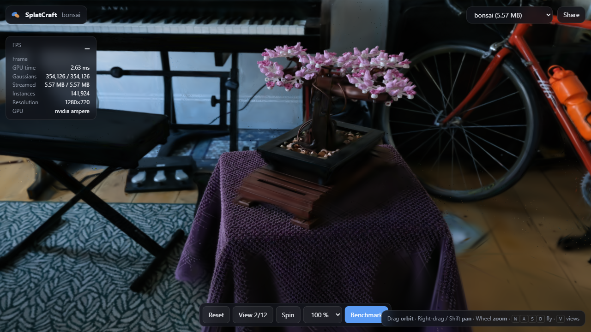
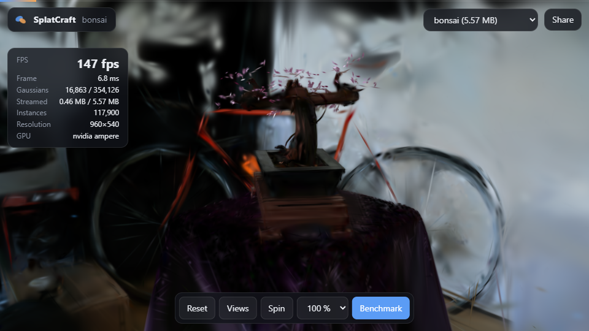
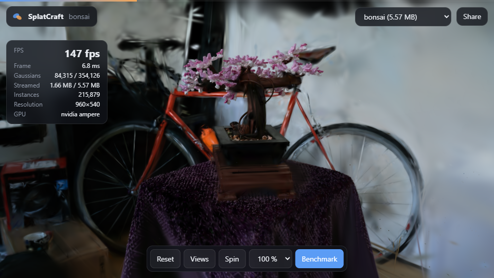
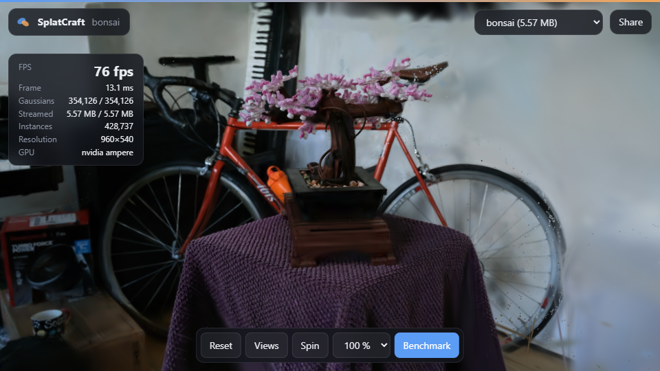

# SplatCraft

**Browser-native 3D Gaussian Splatting: trainer, compressor and WebGPU viewer.**

Film a slow walk around an object or a room. SplatCraft recovers the camera poses, trains a
photoreal 3D Gaussian Splatting scene from the video, compresses it about 15x into a streamable
`.splatc` file of a few MB, and gives you a link that opens in a normal browser on a phone or a
laptop, where a hand-written WebGPU renderer orbits it at high frame rates.

**Live demo:** <https://ashishisaac.github.io/SplatCraft/> (lego) ·
[bonsai](https://ashishisaac.github.io/SplatCraft/?scene=bonsai), published from `web/` by
`.github/workflows/pages.yml`. It needs a WebGPU browser: Chrome, Edge or Opera on desktop or
Android, Safari 26+, or Firefox 141+ on Windows.



| | lego (synthetic) | bonsai (real capture) |
|---|---|---|
| Trained scene (`.ply`) | 44.1 MB · 33.95 dB PSNR | 88.3 MB · 29.76 dB PSNR |
| **Streamed scene (`.splatc`)** | **2.94 MB (15.0×) · 33.34 dB** | **5.57 MB (15.8×) · 29.00 dB** |
| WebGPU, RTX 3050 Laptop, 1920×1080 | 387 fps (2.0 ms GPU) | 258 fps (4.1 ms GPU) |
| WebGPU, Intel Iris Xe (integrated), 1280×720 | 16 fps | 12 fps |
| Training (30k iterations, RTX 3050 Laptop) | 41 min | 2 h* |

PSNR is measured on held-out test views after decoding the file the viewer streams. Full table,
rate-distortion sweep and per-stage GPU timings are in [Benchmark](#benchmark).
\* bonsai shared the GPU with another run for part of its training.

---

## Contents

1. [What is built here (and what is not)](#what-is-built-here-and-what-is-not)
2. [Quick start: one command](#quick-start-one-command)
3. [Step by step](#step-by-step)
4. [Benchmark](#benchmark)
5. [How it works](#how-it-works)
6. [Command line](#command-line)
7. [Repository layout](#repository-layout)
8. [Testing and CI](#testing-and-ci)
9. [Configuration](#configuration)
10. [Troubleshooting](#troubleshooting)
11. [Limitations and next steps](#limitations-and-next-steps)

---

## What is built here (and what is not)

| Part | Built here | Off the shelf |
|---|---|---|
| Camera poses + sparse seed points | frame selection (sharpest frame per time slice), undistortion, scene I/O | COLMAP SfM via `pycolmap` (deliberately not the focus) |
| **Differentiable splat optimisation** | projection, tile binning, **custom autograd rasterizer** (PyTorch) + **fused Triton kernels**, SH colour, L1 + D-SSIM, Adam surgery for densify / split / prune / opacity reset, importance compaction | PyTorch autograd for the projection |
| **Scene compression** | importance pruning, **k-means vector quantisation** of the SH coefficients, scalar quantisation, Morton ordering + delta coding, **interleaved rANS entropy coder** (Python encoder/decoder and JS decoder), progressive chunked `.splatc` format | — |
| **WebGPU renderer** | WGSL compute: preprocess, prefix scan, key emission, **GPU radix sort**, tile ranges, **tile-based alpha blending**, streaming decode, orbit / touch controls, benchmark mode | no Three.js, no splat library |
| Product | FastAPI upload app, job queue, share links, scene gallery, benchmark table, one-command installer | — |

---

## Quick start: one command

You need Python 3.10–3.12, and ideally an NVIDIA GPU with a recent driver.

```bash
git clone https://github.com/AshishIsaac/SplatCraft.git
cd SplatCraft
python run.py          # Windows: double-click start.bat · macOS/Linux: ./start.sh
```

The first run opens a setup window. It creates a private `.venv`, installs PyTorch (the CUDA build
when an NVIDIA GPU is present, otherwise the CPU build), Triton (Windows), SplatCraft, the two
benchmark scenes (~500 MB) and the LPIPS weights (~760 MB). It then trains a tiny scene to verify
everything works and opens the web app at <http://localhost:8770>. Later runs start the app straight
away. An interrupted setup resumes where it stopped.

Options:

```bash
python run.py --home D:\SplatCraftData --venv D:\SplatCraftData\venv   # keep big files elsewhere (remembered)
python run.py --host 0.0.0.0     # reachable from phones on the same Wi-Fi (share links work there)
python run.py --cpu              # no NVIDIA GPU (training is much slower)
python run.py --reinstall        # rebuild the environment from scratch
```

---

## Step by step

### 1. Capture

* Walk slowly around the object (or along the room) for 20–60 s and keep it in frame. Cover it from
  a few heights if you can.
* Avoid motion blur, moving people, and plain textureless walls (SfM needs texture).
* Any phone video works (`.mp4`, `.mov`, ...). A `.zip` of photos works too.

### 2. Upload

Open <http://localhost:8770>, drop the video, choose **Quick** (7k iterations, ~10–25 min on a laptop
GPU) or **Full** (the paper's 30k schedule), and press **Build 3D scene**. The job card shows the
stage and progress live:

| Stage | What happens | Typical time (RTX 3050 laptop) |
|---|---|---|
| Frames | 120 frames, the sharpest of each time slice (Laplacian variance) | seconds |
| Poses | SIFT features, sequential matching, incremental mapping, undistortion (pycolmap, CPU) | 5–15 min |
| Train | 3DGS optimisation, densification, compaction | Quick ~10 min, Full ~45–60 min |
| Compress | importance pruning, SH codebook, quantisation, rANS | under a minute |

### 3. Share

When the job finishes, **Open** shows the scene and **Copy link** copies `http://<host>:8770/v/<name>`.
Anyone who can reach the server can open it. To host a scene without the server, copy its `.splatc`
into `web/scenes/` and push: GitHub Pages serves it at `.../SplatCraft/?scene=<name>`.

### 4. Viewer controls

| Input | Action |
|---|---|
| drag / one finger | orbit |
| right-drag, Shift-drag / two fingers | pan |
| wheel / pinch | zoom |
| W A S D, arrow keys | fly |
| Q / E | orbit left / right |
| V or **Views** | snap to the capture cameras |
| R or **Reset** | start view |
| **Benchmark** | 360° orbit rendered back to back; reports FPS and GPU time per stage, and adds it to the server's table |
| `?scale=0.5` | render resolution (lower for older phones) |
| `?ui=0` | hide the interface |

### 5. From the command line instead

```bash
.venv/Scripts/activate                              # Windows (Linux/macOS: source .venv/bin/activate)
splatcraft process my_walk.mp4 --name desk           # capture -> train -> compress -> publish
splatcraft serve                                     # then open http://localhost:8770/v/desk
```

Or step by step:

```bash
splatcraft capture my_walk.mp4 --name desk           # frames + COLMAP -> workspace/captures/desk/scene
splatcraft train desk -c quick --eval --publish desk # train, compress, PSNR/SSIM/LPIPS, publish
```

Existing COLMAP folders (`images/` + `sparse/0`) and NeRF-synthetic folders (`transforms_*.json`)
train directly: `splatcraft train path/to/scene`.

### 6. Reproduce the benchmark

```bash
splatcraft data download all
splatcraft bench                 # 30k-iteration models; `--quick` for 7k
```

This trains lego and bonsai, evaluates the `.ply`, encodes five `.splatc` variants, evaluates each
decoded file on the held-out views, and times every variant in Chrome on every GPU the browser can
reach. It writes `benchmarks/results/BENCHMARK.md` and `benchmark.json`; the web app shows the table.

---

## Benchmark

Generated by `splatcraft bench` on an RTX 3050 6 GB laptop. The raw output is
[benchmarks/results/BENCHMARK.md](benchmarks/results/BENCHMARK.md) and
[benchmark.json](benchmarks/results/benchmark.json). Quality: all 200 lego test views at 800×800;
bonsai at 1/4 resolution (800×533, every 8th photo held out), LPIPS-VGG. FPS: a 360° orbit rendered
back to back in Chrome on the integrated Intel Iris Xe (`intel gen-12lp`) and on the RTX 3050
(`nvidia ampere`, via `--force_high_performance_gpu`).

| Scene | File | Size | vs .ply | Gaussians | PSNR ↑ | SSIM ↑ | LPIPS ↓ | FPS intel gen-12lp @ 1280x720 | FPS intel gen-12lp @ 1920x1080 | FPS nvidia ampere @ 1280x720 | FPS nvidia ampere @ 1920x1080 |
|---|---|---:|---:|---:|---:|---:|---:|---:|---:|---:|---:|
| lego | `3dgs-ply` | 44.06 MB | 1.0x | 177,643 | 33.95 | 0.975 | 0.031 | – | – | – | – |
| lego | `splatc` | 2.94 MB | 15.0x | 177,546 | 33.34 | 0.972 | 0.035 | 16.4 | 13.8 | 299 | 386.5 |
| lego | `splatc-small` | 1.78 MB | 24.8x | 106,527 | 31.19 | 0.962 | 0.045 | 24.8 | 20 | 452.8 | 436.4 |
| lego | `splatc-tiny` | 1.05 MB | 42.1x | 62,141 | 26.63 | 0.931 | 0.072 | 36.9 | 28.8 | 483.9 | 419.1 |
| lego | `splatc-deflate` | 2.93 MB | 15.1x | 177,546 | – | – | – | – | – | – | – |
| lego | `splatc-no-entropy` | 3.57 MB | 12.3x | 177,546 | – | – | – | – | – | – | – |
| bonsai | `3dgs-ply` | 88.30 MB | 1.0x | 356,051 | 29.76 | 0.922 | 0.233 | – | – | – | – |
| bonsai | `splatc` | 5.57 MB | 15.8x | 354,126 | 29.00 | 0.906 | 0.254 | 12.3 | 8.5 | 331.1 | 257.8 |
| bonsai | `splatc-small` | 3.33 MB | 26.5x | 212,475 | 27.64 | 0.884 | 0.276 | 16.3 | 10.5 | 403 | 301 |
| bonsai | `splatc-tiny` | 1.94 MB | 45.5x | 123,944 | 24.29 | 0.815 | 0.329 | 21.6 | 12.6 | 425.4 | 319.7 |
| bonsai | `splatc-deflate` | 5.58 MB | 15.8x | 354,126 | – | – | – | – | – | – | – |
| bonsai | `splatc-no-entropy` | 6.92 MB | 12.8x | 354,126 | – | – | – | – | – | – | – |

**Reading the table**

* **Compression.** The default `.splatc` is 15–16× smaller than the trained `.ply` for −0.6 dB
  (lego) and −0.8 dB (bonsai). `splatc-small` (prune 40% by importance, 2048-entry SH codebook) is
  25–27× smaller; `splatc-tiny` is 42–45× smaller and degrades visibly. Pruning by importance is
  also the strongest speed knob on weak GPUs (lego on Iris Xe: 16 → 25 → 37 fps).
* **Entropy coding.** rANS saves 18% over the raw quantised streams (3.57 → 2.94 MB). On these
  byte planes it ends up level with DEFLATE (LZ77 + Huffman, 2.93 MB): the planes have little
  repetition for LZ77 to exploit, and order-0 statistics are what both coders capture. rANS stays
  the default because it decodes in a simple tight loop with no dictionary state (and could take
  per-plane context models next). The `deflate` option uses the browser's built-in
  `DecompressionStream`.
* **Speed.** On the RTX 3050 the whole frame costs 1–4 ms of GPU time (preprocess, scan, emit,
  radix sort, ranges, blend). The measured 250–480 fps is bounded by the browser's per-frame
  submission cost, not the GPU. On the integrated GPU, blending and the radix sort dominate (see
  the per-stage table in BENCHMARK.md). The viewer therefore lowers its render resolution
  automatically when frames take more than 40 ms.
* **Context.** The 3DGS paper reports ≈33.3 dB on average over the NeRF-synthetic scenes. This
  lego model reaches 33.95 dB with 178k Gaussians, capped at 300k for a 6 GB GPU, then compacted
  to 60% by importance. Bonsai is evaluated at half the paper's resolution, so its numbers are not
  directly comparable.

**Progressive streaming.** Bonsai on a throttled ~4 Mbit/s connection. Gaussians arrive most
important first, in chunks of doubling size: 5.6k Gaussians (first 0.4 MB, 1.6% of the scene), then
84k, then all 354k.

| | | |
|---|---|---|
|  |  |  |

**Densification ablation** ([ablation.md](benchmarks/results/ablation.md)). On lego with the quick
schedule, halving the clone/split gradient threshold to 1e-4 gives +1.9 dB. Importance compaction
removes 40% of the Gaussians at no measurable cost (31.57 vs 31.48 dB).

**Correctness of the viewer.** The WebGPU render of a capture camera matches the PyTorch render of
the same decoded file at 56–59 dB PSNR on both GPUs, and at > 45 dB on Chrome's software adapter in
CI.

---

## How it works

Full design notes with diagrams: [docs/architecture.md](docs/architecture.md). File format:
[docs/format.md](docs/format.md).

### Training: a differentiable rasterizer written from scratch

```
Gaussians (mean, log-scale, quaternion, opacity logit, 16 SH coeffs x RGB)
  -> project(): EWA splatting, 2D covariance J W Sigma W^T J^T + 0.3 I, SH -> RGB      [autograd]
  -> bin_gaussians(): (tile, Gaussian) pairs, depth sort, stable tile sort            [integer ops]
  -> blend: per tile, front to back, alpha = min(0.99, o * exp(-d^T Sigma^-1 d / 2))  [custom backward]
  -> loss = 0.8 * L1 + 0.2 * (1 - SSIM)
```

The blend step has two implementations of identical math:

* **`gs/rasterizer.py`**: PyTorch tensor ops over *depth slabs* (32 Gaussians × all active tiles ×
  256 pixels per step). The custom backward stores only the transmittance at the start of each
  slab, then re-computes slabs back to front under autograd. Memory is O(one slab), it runs on any
  device (CPU CI included), and it is the reference implementation.
* **`gs/triton_raster.py`**: fused Triton kernels, one program per tile. In-block transmittance
  comes from a cumulative sum of log(1 − α). The backward pass walks front to back, gets the colour
  behind each Gaussian as `C_final − prefix`, and `atomic_add`s per-Gaussian gradients. It is
  **~20× faster** than the tensor-op path (45 vs 908 ms per training step on lego at 800×800, 178k
  Gaussians, RTX 3050 Laptop).

Both are tested against a dense O(N × pixels) autograd rasterizer in float64, gradients included
(`tests/test_rasterizer.py`).

Densification follows Kerbl et al. (2023): a positional-gradient threshold in NDC space, clone small
Gaussians and split large ones, an opacity reset every 3k iterations, and pruning by opacity,
screen size and world size. The Adam moments are remapped on every edit. Once densification ends,
a compaction step removes the 40% of Gaussians that contribute least, measured as summed blend
weight over all training views.

### Compression: 248 bytes → ~15–20 bytes per Gaussian

| Attribute | Raw `.ply` | `.splatc` |
|---|---|---|
| position | 3 × f32 | 16-bit per axis in Morton order, zig-zag delta mod 2¹⁶, rANS per byte plane |
| scale | 3 × f32 | 8-bit log-scale |
| rotation | 4 × f32 | 8-bit per component (w ≥ 0) |
| opacity | f32 | 8-bit |
| base colour | 3 × f32 | 8-bit SH DC |
| view-dependent colour | **45 × f32** | **one 12-bit index** into an importance-weighted k-means codebook (4096 × 45, 8-bit) |
| normals (unused) | 3 × f32 | — |

Every attribute plane is entropy coded with **interleaved rANS** (`compress/rans.py`). Its lanes are
vectorised in NumPy for encoding and transcribed into JavaScript for decoding, and the whole lego file
(73 streams, tables included) lands 1.4% above its order-0 entropy. Gaussians are stored in importance order, in chunks of doubling size,
so the viewer can draw the most important 1–2% within the first few hundred KB and refine the scene
as the rest streams in.

### Rendering: a WebGPU compute pipeline

```
preprocess (1 thread / Gaussian) -> scan (tile counts) -> emit keys (tile << d | depth)
  -> radix sort (4 x 8-bit LSD passes: histogram, scan, stable scatter) -> tile ranges
  -> raster (64 threads per 16x16 tile, 2x2 pixels per thread, front to back, early exit) -> blit
```

* The radix sort's stable scatter ranks keys inside a 1024-key block with eight one-bit splits, each
  a workgroup prefix sum.
* The depth key keeps the top bits of the IEEE-754 depth below the tile index, so a single 32-bit
  sort orders by tile and then by depth.
* The instance buffer is sized from the previous frame's count, read back asynchronously so it
  never stalls: it grows immediately on overflow and shrinks lazily.
* With `timestamp-query`, every stage records its GPU time, and the benchmark reports them.
* **Correctness check**: the browser render of a capture camera matches the PyTorch render of the
  same decoded file to **56–59 dB PSNR** on real GPUs. CI runs the same test on Chrome's software
  (SwiftShader) adapter (`tests/test_viewer_browser.py`).

---

## Command line

```
splatcraft data download [lego|bonsai|all]
splatcraft capture VIDEO|FOLDER|ZIP --name NAME
splatcraft train DATA [-c smoke|quick|full] [--name RUN] [--eval] [--publish NAME] [--set key=value ...]
splatcraft compress RUN [--set compress.sh_codebook=2048] [--eval] [--publish NAME]
splatcraft eval RUN
splatcraft publish RUN NAME
splatcraft process VIDEO --name NAME
splatcraft serve [--host 0.0.0.0] [--port 8770]
splatcraft bench [--quick] [--scenes lego bonsai] [--no-browser] [--no-train]
splatcraft doctor
```

---

## Repository layout

```
run.py, start.bat, start.sh     one-command setup + launch (stdlib only)
src/splatcraft/
  scene/        cameras, COLMAP + NeRF-synthetic readers, video frames + pycolmap SfM, downloads
  gs/           Gaussian model + densification, rasterizer (torch), triton_raster (GPU kernels),
                SH, losses, trainer
  compress/     rANS coder, k-means VQ, .splatc codec
  eval/         PSNR / SSIM / LPIPS
  bench/        benchmark runner + browser FPS (Playwright)
  server/       FastAPI app, job queue, dashboard (static/)
  pipeline.py   train -> compress -> evaluate -> publish on a run directory
web/            the WebGPU viewer (static, GitHub Pages) + demo scenes
configs/        default.yaml + smoke / quick / full presets
benchmarks/     results/BENCHMARK.md + benchmark.json (committed)
docs/           architecture.md (C4 / mermaid), format.md (.splatc spec)
tests/          gradients, codec, rANS, API, launcher, browser
docker/         Dockerfile, entrypoint
```

---

## Testing and CI

```bash
pytest                      # everything (browser test skips without Chrome / WebGPU)
pytest -m "not browser"     # what the test matrix runs
splatcraft doctor           # installation check + 10-second training smoke test
```

| CI job | Checks |
|---|---|
| lint | ruff; every JS file parses |
| test | Linux + Windows × Python 3.10 / 3.12: gradients vs dense autograd, Triton vs torch (on GPU), rANS, codec round trips incl. delta wrap-around, API (upload → job → share link, path safety), launcher |
| viewer | headless Chrome, SwiftShader WebGPU: viewer render == PyTorch render (> 45 dB) |
| smoke | real lego data on CPU: train → compress → decode → PSNR/SSIM/LPIPS gates |
| docker | image builds, serves the demo scene |
| pages | deploys the live demo |

---

## Configuration

`configs/default.yaml` documents every knob. The presets `smoke`, `quick` and `full` override it,
and so does `--set section.key=value` on any command. The most useful knobs:

| Key | Default | Effect |
|---|---|---|
| `data.max_width` | 640 (quick) / 800 (full) | training resolution |
| `train.iterations` | 7000 / 30000 | schedule length |
| `train.max_gaussians` | 400k / 600k | densification cap (6 GB GPUs) |
| `densify.grad_threshold` | 0.0002 | lower = more Gaussians, more detail |
| `compaction.keep` | 0.6 | fraction kept by importance after densification |
| `compress.sh_codebook` | 4096 | SH codebook size (smaller = smaller file, flatter reflections) |
| `compress.prune_keep` | 1.0 | extra importance pruning at compression time |
| `compress.entropy` | rans | rans / deflate / none |

---

## Troubleshooting

| Symptom | Fix |
|---|---|
| "WebGPU is not available" | Use current Chrome / Edge / Opera, Safari 26+, or Firefox 141+ on Windows. On Linux Chrome enable `chrome://flags/#enable-unsafe-webgpu`. |
| Laptop renders on the integrated GPU | Chrome on Windows ignores the WebGPU power preference. Set Chrome to "High performance" in Windows Graphics settings, or start it with `--force_high_performance_gpu`. |
| SfM registered only a few frames | Walk slower, keep more overlap, avoid blur and textureless areas, or upload more frames. |
| Training is slow / "Triton kernels: not used" in `splatcraft doctor` | Install `requirements/triton-windows.txt` (Windows) or use a Linux PyTorch build (which bundles Triton). The fallback tensor-op rasterizer is correct but ~20× slower. |
| CUDA out of memory | Lower `train.max_gaussians` or `data.max_width`. |
| Setup failed | See `.setup/install.log`, then run `python run.py` again (it resumes). |

---

## Limitations and next steps

* Pose seeding is COLMAP only. MASt3R would make SfM robust to low-texture videos, and the scene
  loader already accepts any COLMAP-format folder it produces.
* Compression is post-training. Quantisation-aware fine-tuning of the codebooks (as in
  CompGS / c3dgs) would recover another ~0.2–0.5 dB at the same size.
* The viewer sorts all tile instances every frame. Integrated and mobile GPUs spend most of their
  time in blending and sorting (see the per-stage table), so the next step is per-tile splat culling
  with exact ellipse–tile overlap and temporal sort reuse.

## References

* B. Kerbl, G. Kopanas, T. Leimkühler, G. Drettakis. *3D Gaussian Splatting for Real-Time Radiance
  Field Rendering.* SIGGRAPH 2023.
* Z. Fan et al. *LightGaussian.* NeurIPS 2024 (global-significance pruning).
* S. Niedermayr, J. Stumpfegger, R. Westermann. *Compressed 3D Gaussian Splatting for Accelerated
  Novel View Synthesis.* CVPR 2024 (vector-quantised SH).
* J. Duda. *Asymmetric numeral systems.* 2013 (rANS).
* J. L. Schönberger, J.-M. Frahm. *Structure-from-Motion Revisited.* CVPR 2016 (COLMAP).

MIT licence: see [LICENSE](LICENSE), which also lists the third-party data and model terms.
Author: Ashish V Isaac.
