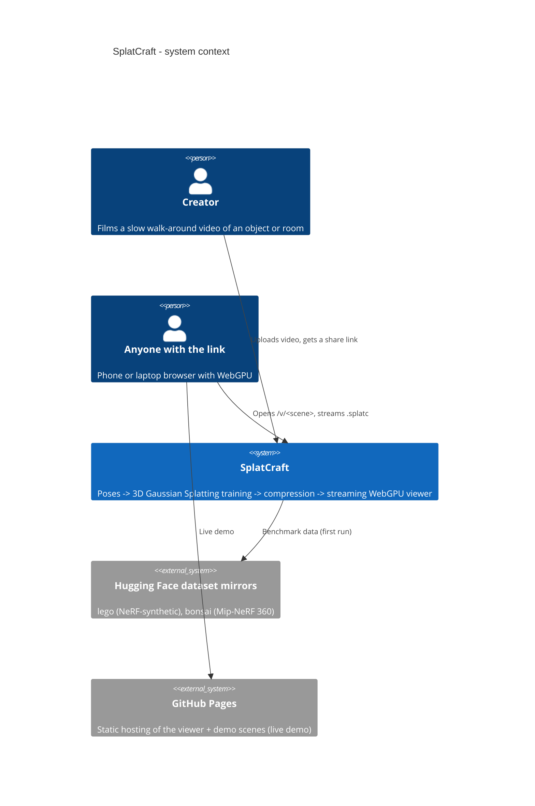
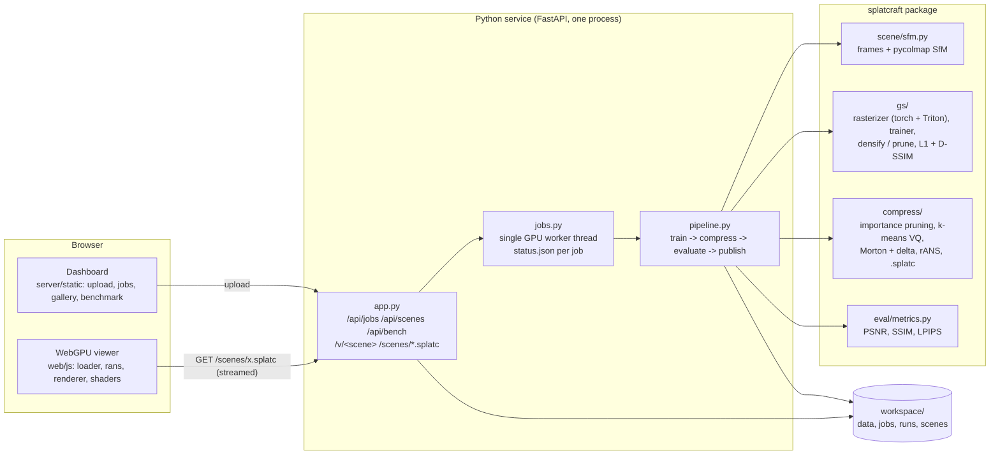
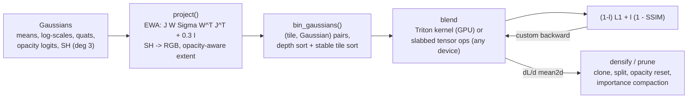
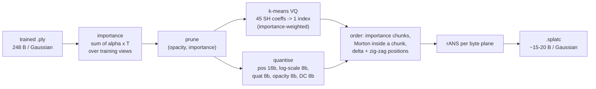
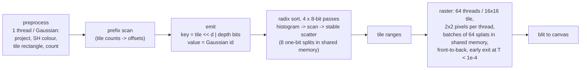

# SplatCraft architecture

## Context (C4 level 1)

## Containers (C4 level 2)

## The three engineered pieces

### 1. Differentiable splat optimisation (`src/splatcraft/gs/`)

* **Projection** is plain autograd. Small per-Gaussian matrix products are written as broadcast
  multiply-sums (batched GEMMs of 2x3 matrices were 20x slower), and SH evaluation is one basis
  matrix and one contraction (per-coefficient slicing allocated a full-size gradient per
  coefficient in the backward pass).
* **Blending** has two implementations of the same math:
  * `rasterizer._Rasterize`: tensor ops over *depth slabs* (K Gaussians x all active tiles x 256
    pixels per step). The custom backward stores only each slab's starting transmittance and
    re-computes slabs back to front under autograd: O(slab) memory. Runs anywhere, and is the
    reference the GPU kernels are tested against.
  * `triton_raster.py`: one Triton program per tile, blocks of 16 Gaussians, in-block
    transmittance by a cumulative sum of log(1 - alpha). The backward pass walks front to back and
    obtains the colour behind each Gaussian as `C_final - prefix`, then reduces per-Gaussian
    gradients over the tile and `atomic_add`s them.
* **Tests**: both paths match a dense O(N x pixels) autograd rasterizer in float64
  (`tests/test_rasterizer.py`), and each other on the GPU, including gradients.
* **Densification** follows Kerbl et al.: NDC-space positional-gradient threshold 2e-4, clone
  below 1 % of the scene extent, split (2 samples, 1/1.6 scale) above, opacity reset every 3k
  iterations, pruning by opacity / screen size / world size. Adam moments are remapped on every
  clone, split and prune. A LightGaussian-style *compaction* step prunes the least important 40 %
  (summed blend weight over all training views) once densification ends.

### 2. Scene compression (`src/splatcraft/compress/`)

See [format.md](format.md) for the byte layout.

### 3. WebGPU renderer (`web/js/`)

Per frame, all compute (no Three.js, no rasterisation pipeline for the splats):

* **Depth key**: positive IEEE-754 floats sort like their bit patterns, so the key keeps the top
  `32 - tileBits` bits of `z` (sign bit dropped) below the tile index: one 32-bit sort orders by
  tile, then depth.
* **Instance buffer** is sized from the previous frame's count (read back asynchronously, no
  stall): grows at once on overflow, shrinks after 20 frames at < 1/3 use, because the sort's cost
  scales with the buffer, not with the count.
* **Streaming**: `loader.js` reads the response body incrementally; the header, the codebook and
  each chunk are decoded (rANS in JS) the moment their bytes are in and written into the GPU
  buffers at their final offsets, so the scene renders while it downloads.
* **Profiling**: with `timestamp-query`, every stage is its own compute pass with GPU timestamps
  (`renderer.stageMs`); the benchmark table reports them per GPU.

## Coordinate conventions (shared by every component)

* Cameras: OpenCV (x right, y down, z forward), world -> camera `R`, `t`.
* Pixel `(i, j)` has its centre at `(i + 0.5, j + 0.5)`, principal point in the same frame (COLMAP).
* Quaternions `(w, x, y, z)`; colour = `SH . basis(dir) + 0.5`, clamped at 0; `dir` from the camera
  centre to the Gaussian.
* NeRF-synthetic `transform_matrix` (OpenGL camera-to-world) is converted on load.

## CI/CD

| Job | Runs | Proves |
|---|---|---|
| lint | ruff, `node --check` on all JS | style, syntax |
| test | Linux + Windows x Python 3.10/3.12, CPU torch | gradients vs dense autograd, rANS, codec round trips, API, launcher |
| viewer | headless Chrome, SwiftShader WebGPU | WebGPU render == PyTorch render (> 45 dB) |
| smoke | CPU, real lego data | train -> compress -> decode -> PSNR/SSIM/LPIPS gates |
| docker | image build | web app serves the demo scene |
| pages | push to main | live demo on GitHub Pages |

GPU work (training at full schedule, browser FPS on real GPUs) runs with `splatcraft bench` on a
GPU machine; its output (`benchmarks/results/`) is committed.
